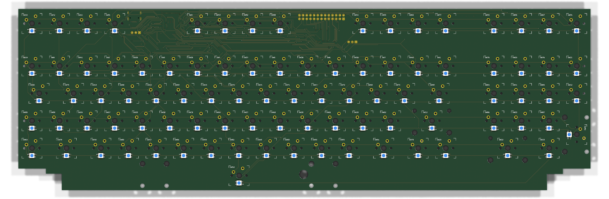
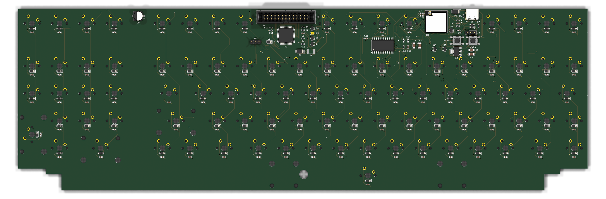
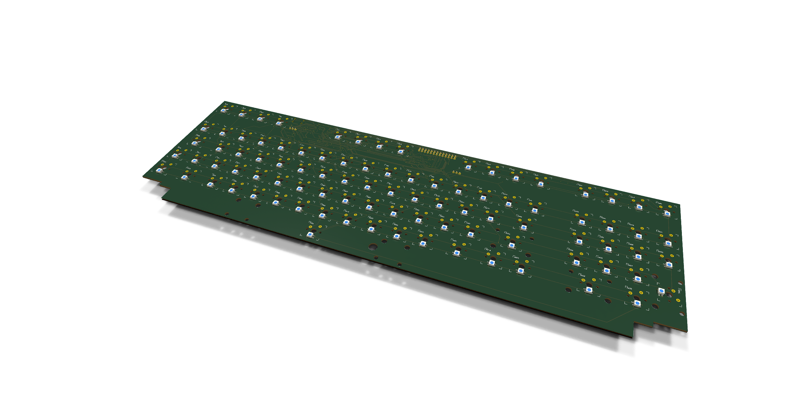
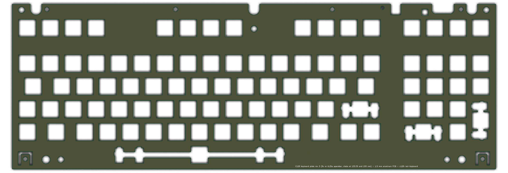

# c128-led-keyboard

A mechanical keyboard for the Commodore 128 with a microcontroller on board: an ESP32-S3
scans the switches and presents them to the C128 through a CH446Q analog crosspoint, so the
computer sees an ordinary keyboard matrix while the board adds per-key RGB lighting, lock
keys that remember their state, a rear-exit connector in stock C128 pin order and, later, a
command layer, USB keyboard mode and a network keyboard.

The plate, a 1.5 mm aluminum PCB with stabilizer slots for a 9u or a 6.25u spacebar:

Renders are regenerated by GitHub Actions whenever the board or plate changes on `main`
(`make render` does the same locally, in KiCad's container).

Status (2026-11-23): schematic passing ERC; **board laid out, fully routed and DRC clean**,
with the JLCPCB order files (gerbers, BOM, placement) generated and checked in the fab's
placement preview; plate ready as one aluminum board that takes either spacebar.  Quoted at
about 500 USD for five assembled boards shipped, plus about 50 USD for the plate; not ordered
yet.  Bench firmware runs on a devkit; the bench proofs have not started.  The plan and its reasoning are in [docs/rev3-plan.md](docs/rev3-plan.md).

## What is here

| folder | what |
|---|---|
| [`pcb/`](pcb/README.md) | KiCad 10 project for the board (generated schematic, BOM), the plate as an aluminum-PCB board (takes a 9u or a 6.25u spacebar), JLCPCB order files, bench notes for proving the circuit |
| [`layout/`](pcb/README.md#layout-data) | the switch positions, matrix nets and plate outline every generator reads |
| [`firmware/`](firmware/README.md) | ESP-IDF project for the ESP32-S3, built in Docker, with a Wokwi simulation |
| [`keycaps/`](keycaps/README.md) | legend map, front-legend artwork and vendor notes for an MX keycap set, and the 9u spacebar drawing |
| [`docs/`](docs/) | the rev 3 plan, a part-by-part circuit walkthrough, and the rev 2.3 issues that motivated it |

The case for the 128D / DCR external keyboard is its own project,
[c128d-keyboard-case](https://github.com/steveed/c128d-keyboard-case).

## Where the measurements come from

This board is new, but the keyboard it describes is not.  The key positions, the C128 matrix
assignment of every key and the plate are, for now, the measurements of the rev 2.3 board and
plate from [the-c128-keyboard-project](https://codeberg.org/jflitton/the-c128-keyboard-project).
They were extracted once into `layout/switches.json` and `layout/plate.json`, and nothing here
reads the original files.  When the new board is laid out, `pcb/tools/extract_layout.py`
re-extracts the switches from it and the plate, firmware keymap and schematic follow; see
[pcb/README.md](pcb/README.md#layout-data).

## Parts from the original project

Some pieces are used as they are and are not copied here:

- keycap adapters for reusing the original Mitsumi caps on MX-style switches, switch shims,
  and the keyboard cable ends:
  [`printable_parts/`](https://codeberg.org/jflitton/the-c128-keyboard-project/src/branch/main/printable_parts)
- the original steel plate for laser cutting:
  [`plate/plate.step`](https://codeberg.org/jflitton/the-c128-keyboard-project/src/branch/main/plate/plate.step)
- the rev 2.3 passive board, which the bench notes use as a test bed:
  [`pcb/`](https://codeberg.org/jflitton/the-c128-keyboard-project/src/branch/main/pcb)

## Datasheets

- CH446Q analog crosspoint (WCH): <https://www.wch-ic.com/downloads/CH446DS1_PDF.html>
- M5Stack NeoPixel / RGB LED units (SK6812), used on the bench:
  <https://docs.m5stack.com/en/unit/neopixel>, <https://docs.m5stack.com/en/unit/rgb>
- Every part the board's footprints, pinouts and fab placement were checked against:
  [pcb/datasheets/README.md](pcb/datasheets/README.md)

## License and credits

This project is a fork of
[the-c128-keyboard-project](https://codeberg.org/jflitton/the-c128-keyboard-project) by
Jeff Flitton, whose PCB was in turn based on the
[original C128 keyboard PCB](https://codeberg.org/jgrip/c128-keyboard) by Johan Grip, maker
of the [C128 Neo](https://c128.se/).  The key layout, matrix assignment and plate
measurements in `layout/`, and everything generated from them, derive from Jeff Flitton's
rev 2.3 board and plate.  The rev 3 circuit, generators, firmware, keycap work and
documentation were written for this repository; none of it is part of the upstream
project, and this project is not endorsed by its authors.

Released, like the project it builds on, under
[Creative Commons Attribution-ShareAlike 4.0 International](LICENSE.md): you may copy,
modify and sell it, including boards and kits, provided you credit the authors, link back,
say what you changed, and release adaptations under the same license.  It is provided as
is, without warranties; see the license for the disclaimer.
